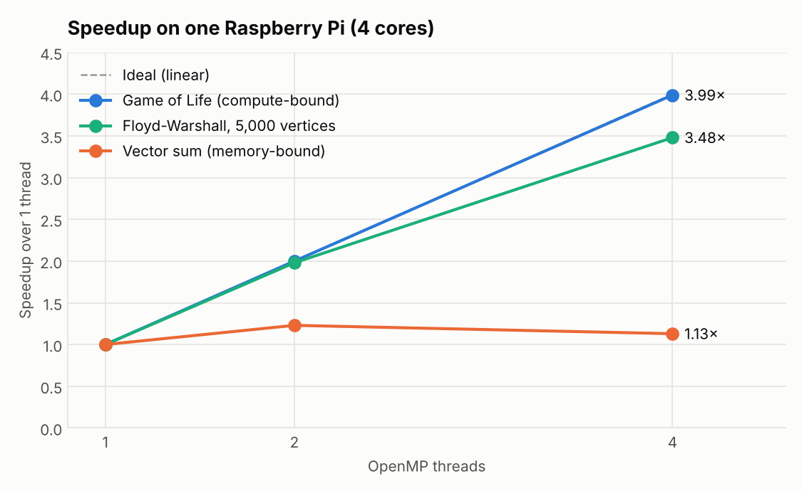
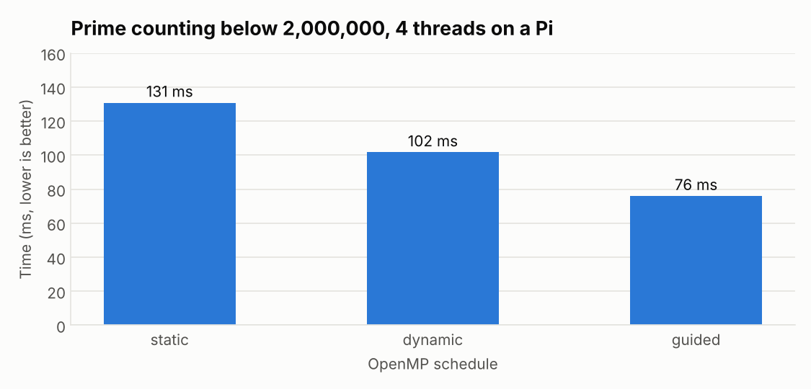
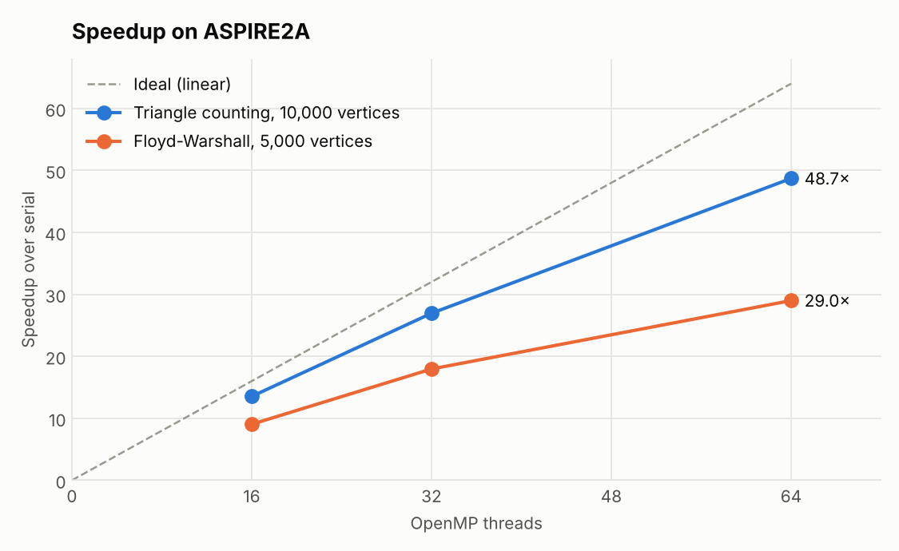
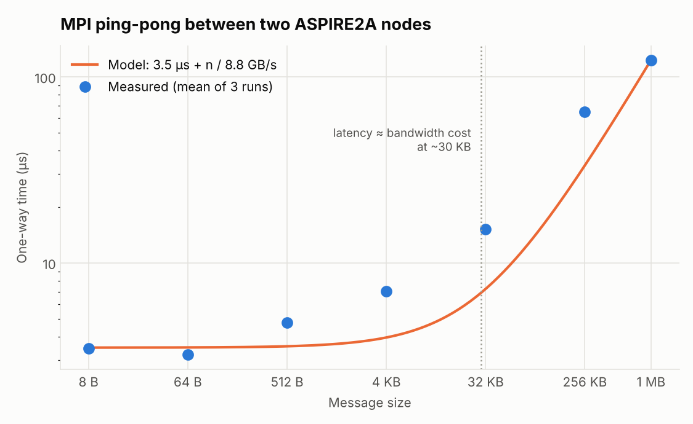

# Parallel Computing: Pi Cluster & HPC Benchmarks

Performance experiments with OpenMP and MPI on a 4-node Raspberry Pi cluster I built and on the ASPIRE2A supercomputer (NSCC Singapore), done as part of SC4050 Parallel Computing at NTU.

This repo covers the cluster build, the measurements and what I learned from them. The lab source code is kept private as course material, and is available on request.

## 1. Building the cluster

Four Raspberry Pis (4 cores each, 16 cores in total) on a private network behind a Linux PC.

```
            internet
               │
        ┌──────┴──────┐
        │  Linux PC   │  DHCP server, IP forwarding, NAT (iptables)
        │192.168.1.100│
        └──────┬──────┘
               │ 192.168.1.0/24
   ┌───────┬───┴───┬───────┐
 rpi1    rpi2    rpi3    rpi4
 .101    .102    .103    .104
 head node: NFS server, Slurm controller
```

- **Networking:** the PC hands out addresses over DHCP at first, then each Pi gets a static IP. The PC forwards and NATs traffic so the Pis can reach the internet.
- **Shared storage:** rpi1 exports `/home/pi/shared` over NFS, and rpi2–4 mount it automatically at boot (`x-systemd.automount`), so every node sees the same binaries and data.
- **Passwordless SSH** between all 4 nodes (12 key copies), which MPI needs to launch remote processes.
- **MPI:** Open MPI with a 4-node hostfile, so 16 ranks run across the cluster.
- **Slurm:** rpi1 runs `slurmctld`, rpi2–4 run `slurmd` (4 CPUs each), with Munge authentication, the backfill scheduler and core-level allocation (`cons_tres`, `CR_Core`).

The configuration files are in [`cluster-config/`](cluster-config/).

## 2. OpenMP: what scales and what doesn't



| Workload (one Pi, 4 threads) | Speedup | Efficiency | Why |
|---|---|---|---|
| Game of Life, 500×500, 5000 steps | 3.99× | 99.8% | Every cell does the same work, reads the old grid and writes only its own new cell, so there's no sharing and `schedule(static)` is ideal |
| Floyd-Warshall, 5,000 vertices | 3.48× | 86.9% | Parallel over rows, but needs a barrier after every `k` step |
| Vector sum, 100M elements | 1.13× | 28.4% | One add per 8-byte load: memory-bandwidth bound, so extra cores just wait on the same memory bus |

The vector sum barely improves on ASPIRE2A either: 4.69× on 64 threads (7.3% efficiency). More cores don't help a loop that's limited by memory.

### Loop scheduling for uneven work



Checking whether *n* is prime costs about √*n*, so the work grows along the loop. `static` gives the last thread the most expensive block; `dynamic` rebalances, but pays for every chunk it hands out; `guided` starts with big chunks and shrinks them, so it balances the load with less overhead. Result: **guided was 1.7× faster than static** on the same 4 cores, and the ranking held across repeated runs.

On ASPIRE2A, with a smaller problem (N = 200,000, about 7 ms in total), `dynamic` with chunk size 1 got *slower* as threads were added (1.63× at 8 threads, 0.95× at 64), because the scheduling overhead outgrew the work.

## 3. Graph algorithms: barriers limit scaling



| ASPIRE2A, 64 threads | Serial | Parallel | Speedup | Efficiency |
|---|---|---|---|---|
| Triangle counting, 10,000 vertices | 70.2 s | 1.44 s | 48.7× | 76% |
| Floyd-Warshall, 5,000 vertices | 71.6 s | 2.47 s | 29.0× | 45% |

Both start from about 70 s serial, but scale very differently:

- **Floyd-Warshall** can't parallelise its outer `k` loop, because step *k* needs the result of step *k−1*. Only the row loop runs in parallel, so all threads synchronise 5,000 times. Efficiency stays around 45–56%.
- **Triangle counting** has independent rows combined with a `reduction`, with no barriers, and stays at 72–85% efficiency.
- **Small graphs don't pay off.** A 500-vertex triangle count ran *slower* at 64 threads than at 16, because starting the threads costs more than the work.

**Spotting bad measurements.** The first triangle-counting job on ASPIRE2A reported 119–186% efficiency, which is impossible. A 1-thread control run (1.00× vs. serial) showed the code was fine and the serial baseline in that job had run about 2× slow, most likely a contended core on a shared node. A rerun gave consistent numbers. The same thing happened on the Pi cluster, where CPU frequency scaling made one serial run slow (a false 5.0× speedup on 4 cores), and a rerun fixed it.

## 4. MPI communication on ASPIRE2A

### Latency and bandwidth (ping-pong)



Two ranks on **different nodes** bounce messages from 8 B to 1 MB, and I fit the model *T(n) = α + n·β*:

| | Value (mean of 3 runs) |
|---|---|
| Latency α | ≈ 3.5 µs |
| Bandwidth 1/β | ≈ 8.8 GB/s |
| Break-even size n\* = α/β | ≈ 30 KB |

Below about 30 KB, a message's cost is mostly latency, so batching small messages pays off. Above it, bandwidth dominates. For comparison, Gigabit Ethernet on the Pi cluster would be tens of µs and about 0.1 GB/s.

The two-point fit (from the 8 B and 1 MB points) **underestimates mid-sized messages** (512 B–256 KB). That's expected: MPI libraries switch protocols as messages grow (eager vs. rendezvous), so one straight line can't fit every size.

### Overlapping communication with computation

Four ranks in a ring each exchange about 16 MB with both neighbours while doing independent computation:

| | Blocking `MPI_Sendrecv` | Non-blocking `Isend`/`Irecv` + compute + `Waitall` | Saved |
|---|---|---|---|
| Run 1 | 24.0 ms | 15.2 ms | 37% |
| Run 2 | 24.5 ms | 17.9 ms | 27% |

The ceiling is 50%, reached only when communication and computation take exactly the same time.

### Also built

- A **collector** using `MPI_ANY_SOURCE` / `MPI_ANY_TAG`, reading the real sender from `MPI_Status`. Messages arrived in a different order every run, and it passed every time.
- A **ring all-reduce** that passes values round the ring in *P−1* steps, verified for P = 4, 5, 9. It's linear in *P*, unlike `MPI_Allreduce`'s tree or butterfly algorithms, which take about log₂*P* steps.

## 5. Takeaways

- **Find the bottleneck before adding threads.** Compute-bound code (Game of Life) scaled perfectly; memory-bound code (vector sum) barely moved on 64 cores.
- **Synchronisation is a cost.** The barrier after every `k` step is the difference between Floyd-Warshall's 45% efficiency and triangle counting's 76%.
- **Match the schedule to the work.** For uneven loops, `guided` beat `static` by 1.7×.
- **Small problems don't parallelise.** Below a few milliseconds of work, thread and message overheads dominate.
- **Check measurements against physics.** Efficiency above 100% means the baseline is wrong; control runs and reruns found the cause twice.
